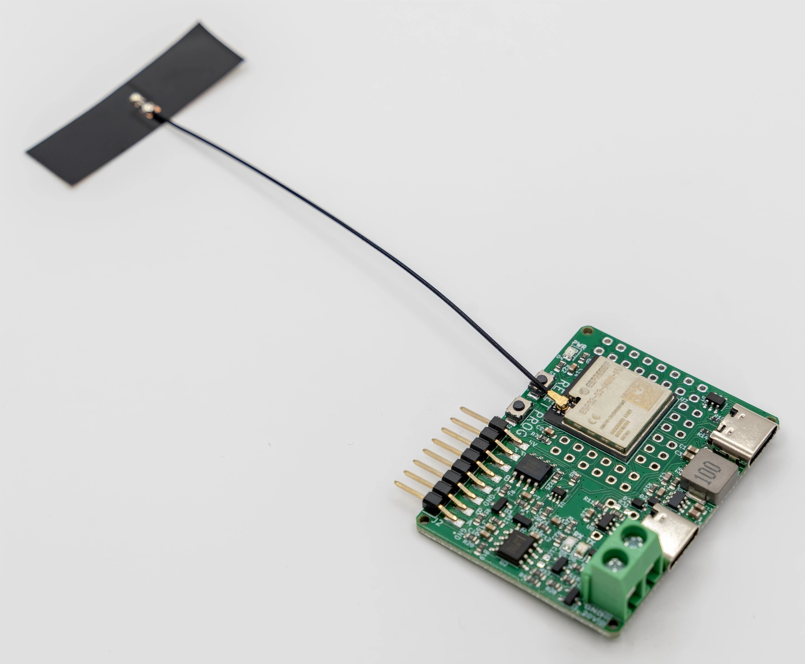

# Gearotons RS485 Controller

A programmable ESP32-S3 board with a half-duplex RS485 interface for Gearotons servomotors and other RS485 devices. The product includes an external antenna. One unit weighs **11.7 g including the antenna**.

## Documentation

[RS485 Controller hardware 0.5 documentation](https://9o.at/products/rs2/0.5) includes the datasheet, schematic and product photographs. The QR code printed on the PCB resolves to this page. Its content is generated from [`PRODUCT_DATA.yaml`](PRODUCT_DATA.yaml), using the same system as the RS485 Adapter and M17 Servomotor.

## Datasheet

[Download the RS485 Controller datasheet v1.0 (PDF)](datasheet/rs485_controller_datasheet_v1.0.pdf). Covers PCB revision 0.5, connector pinouts, two-motor wiring, mechanical dimensions, breakout headers, Arduino setup and the controller schematic.

## Hardware

The latest numbered PCB revision is **0.5**, in [`PCB/0.5`](PCB/0.5). Open `0.5.kicad_pro` in KiCad; the design was last saved with KiCad 9. The board outline is 48.89 × 36.88 mm, with a nominal PCB thickness of 1.6 mm. These dimensions exclude connector and antenna protrusions.

- ESP32-S3-MINI-1U module with external antenna connector.
- SP3485EN RS485 transceiver; automatic transmit direction circuitry.
- RS485 UART: GPIO4 TX and GPIO5 RX. The supplied demos use 230400 baud, 8N1.
- J5, marked **USB-C PROG**, connects to the ESP32-S3 native USB interface and the 5 V input rail.
- J3, marked **USB-C PD POWER IN**, uses a CH221K to request 20 V with R27 = 200 kΩ. R31 is an optional, unpopulated resistor in the standard design.
- J1, marked **POWER OUT**, exposes the J3 power rail directly: pin 1 positive, pin 2 GND. Actual output voltage depends on the connected supply and PD negotiation. Check the voltage before connecting motors.
- J2 pins 1–8: **GND, A, B, GND, A, B, 3.3 V, 5 V**. The two A/B/GND groups share one bus. Use the PCB labels to identify orientation.

Connect A to A, B to B, and controller GND to the motors' common ground. Motor power must use the appropriate motor supply, never J2's 3.3 V or 5 V pins. The board is not galvanically isolated. A board-level motor-current rating has not been established.

## Programming

Program the ESP32-S3 through J5 using a suitable ESP32-S3 toolchain, such as the Arduino ESP32 core with the Gearotons Servomotor library. Configure RS485 UART RX on GPIO5 and TX on GPIO4. The controller's USB-to-RS485 bridging and wireless application behavior depend on the firmware you install.

## Product images

[`images/rs485-controller`](images/rs485-controller) contains real product photographs, metadata-free JPEGs, full-resolution WebP images and 800-pixel WebP variants. [`manifest.json`](images/rs485-controller/manifest.json) supplies filenames, dimensions, alt text and original source hashes. These paths can be served directly from the public repository; use a pinned commit URL for immutable ecommerce assets.

## Validation of the 0.5 upload

On 2026-10-26, KiCad 9.0.7 error-level DRC with schematic parity reported zero violations, zero unconnected items and zero schematic parity issues. This is a design-file check, not an electrical or thermal qualification of manufactured hardware.

